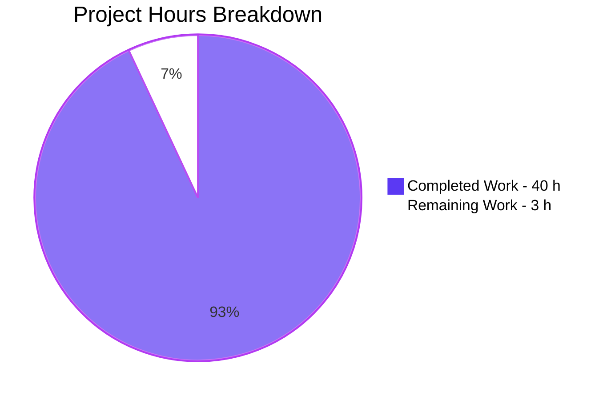

# 1. Executive Summary

A dependency-free Node.js HTTP server, written to be read as much as run: one served endpoint, one deliberate `404`, and the surfaces a real server needs to be operated.

## 1.1 Project Overview

A minimal, dependency-free Node.js HTTP server, written as a beginner tutorial: `GET /hello` answers `200` with `Hello world`, and every other method and path answers `404` `Not Found`. Around that contract sit the surfaces a server needs to be operated — a validated `PORT`, one log line per request, actionable binding errors, and a `SIGINT` shutdown that prints two lines and exits `0`. One 142-line file uses only Node's built-in `http` module, documented by a README run book.

## 1.2 Completion Status

**93% complete — 40 of 43 hours delivered**, measured against the eighteen requirements this work was scoped to. The three remaining hours are path-to-production work on the runtime floor (see 1.4).


Colour key: Completed = dark blue `#5B39F3`; Remaining = white `#FFFFFF`.

| Metric | Value |
| --- | --- |
| Total Hours | 43 |
| Completed Hours (AI + Manual) | 40 |
| Remaining Hours | 3 |
| Completion | 93% |

## 1.3 Key Accomplishments

- `GET /hello` → `200` `Hello world`; every other method and path → `404` `Not Found`.
- Exact, case-sensitive path matching, with the method part of the route key.
- One fixed-format log line per request, before routing, so unmatched requests are logged too.
- `PORT` configuration: default `3000`, the `1024-65535` range enforced, byte-exact refusals with exit `1`.
- Binding errors naming the held port and the remedy, exit `1`, the running server undisturbed.
- A `SIGINT` shutdown printing both lines, exiting `0` and releasing the port even with a stalled connection.
- Zero dependencies — nothing to install, audit or patch — with sub-millisecond responses and flat memory.

## 1.4 Critical Unresolved Issues

One of the eighteen requirements still carries open work: the runtime floor the manifest declares. The code guards for an older runtime, but the release it promises there is unproven.

| Issue | Impact | Owner | ETA |
| --- | --- | --- | --- |
| `engines.node` declares `">=18.0.0"` (`package.json:8`), which admits Node.js 18 — past end of life since 30 April 2025 — and the shutdown's two connection APIs do not exist before 18.2.0 | An install on 18.0/18.1 gets no vendor security patches, and a stalled connection can hold the shutdown instead of releasing the port | Application owner | 3 h — 1 h to settle the floor, 2 h to prove the shutdown on the earliest admitted version |

## 1.5 Access Issues

No access issues identified: no credential, token or third-party access is needed. The server reads one optional variable, `PORT`, and binds one local port.

## 1.6 Recommended Next Steps

1. **[High]** Settle the runtime floor — raise `engines.node` to a supported line or narrow it to `18.2.0` — and align the README (1 h).
2. **[Medium]** Prove the shutdown on the earliest runtime the floor admits, or record the decision to rely on its guards (2 h).
3. **[Medium]** Re-run the README's expected-output blocks after any edit to a body, the header, the route key or a shutdown line.
4. **[Low]** Keep the rationale comments beside their code.

# 2. Project Hours Breakdown

Hours are scoped to the requirements this work delivered and to the path to production. 40 hours are complete and 3 remain, for 43 in total.

## 2.1 Completed Work Detail

| Component | Hours | Description |
| --- | --- | --- |
| HTTP route contract | 8 | The request listener, the method-plus-path decision, the guarded request parse, and the catch-all (`server.js:71-90`), verified across every method and path shape |
| Response writer and fixed literals | 2 | The single header write and single body write serving `Hello world` and `Not Found`, with no trailing newline (`server.js:65-69`) |
| Request logging | 2 | One stdout line per request in the fixed format, emitted before the routing decision (`server.js:59-63, 75`) |
| PORT configuration and validation | 4 | Default `3000`, integer-only parsing, the inclusive `1024-65535` range, and actionable refusals that exit `1` before any bind (`server.js:24-57`) |
| Binding-failure reporting | 3 | The `EADDRINUSE` message naming the port and the remedy, the non-`EADDRINUSE` fallback, and exit `1` (`server.js:94-108`) |
| Startup, shutdown and exit-path integrity | 6 | The startup line, the two shutdown lines in order, the bounded connection close, and final-message delivery before exit `0` (`server.js:110-142`) |
| Performance and stateless concurrency | 3 | Sub-millisecond responses, concurrent service without blocking, and memory flat across load |
| Manifest metadata and zero-dependency posture | 1 | The seven manifest fields, the empty dependency set and the absent lockfile (`package.json`) |
| README run book | 4 | Purpose, prerequisites, run, endpoints, expected output, configuration, shutdown, structure and verified runtime (`README.md`) |
| Contract verification | 5 | The functional, boundary, configuration, operational, adversarial and load sweeps run against the live server |
| Quality and literal consistency | 2 | Every documented value reconciled with the code that owns it, comment discipline, and the placeholder and dead-code sweeps |
| **Total** | **40** | |

## 2.2 Remaining Work Detail

| Category | Hours | Priority |
| --- | --- | --- |
| Runtime-floor decision and documentation — settle `engines.node` and align the README prerequisites | 1 | High |
| Shutdown verification on the earliest admitted runtime — prove the two connection guards' false paths, or record the decision to rely on them | 2 | Medium |
| **Total** | **3** | |

# 3. Test Results

Every check below was run against the delivered files on a live server. The project ships no test framework, runner or instrumentation — its premise is that a reader installs nothing — so verification is the end-to-end exercise of the running server. **66 checks were executed and all 66 returned the documented result.**

| Area / Category | Framework | Tests | Passed | Failed | Coverage | What This Proves |
| --- | --- | --- | --- | --- | --- | --- |
| Route contract and response semantics | Node's built-in `http` client and `curl` against the running server | 14 | 14 | 0 | Not instrumented — no coverage tooling in scope | `GET /hello` answers `200 text/plain` with an 11-byte `Hello world`, and no other method or path returns anything but the 9-byte `Not Found` |
| Boundary and hostile targets | Same | 12 | 12 | 0 | Not instrumented | Path matching is exact and case-sensitive, query strings are excluded, and traversal, percent-encoded, NUL-bearing and malformed targets fall to the catch-all without echoing a path or leaking a stack trace |
| `PORT` configuration and refusals | Same | 11 | 11 | 0 | Not instrumented | The default port and an override both serve, and eight invalid values are refused with the documented message, exit `1` and no socket bound |
| Operational lifecycle — startup, binding errors, shutdown | Same | 12 | 12 | 0 | Not instrumented | The startup line appears only once bound, an in-use port is reported byte-exactly with exit `1` while the running server keeps serving, and one `SIGINT` prints both lines, exits `0` and releases the port |
| Sequential and concurrent load | Same | 5 | 5 | 0 | Not instrumented | 500 sequential and 200 concurrent requests are all served with one log line each, with no dropped request and no non-200 response |
| Latency and memory | Same | 5 | 5 | 0 | Not instrumented | 20 samples stayed between 0.000251 s and 0.000371 s against a 10 ms budget, and memory stayed flat across 1,000 requests |
| Log-format conformance | Same | 4 | 4 | 0 | Not instrumented | 1,739 of 1,739 request lines matched the fixed format, exactly one startup line was emitted, and stderr stayed empty |
| Documentation and invocation surface | `npm`, `curl` and a real browser session | 3 | 3 | 0 | Not instrumented | The README's commands and expected outputs reproduce, `npm start` runs the same server as `node server.js`, and an independent browser client saw the documented statuses and bodies |

**Not Covered**

- **The false path of the two feature-detected connection APIs on the shutdown path** (`server.js:129`, `133-139`). Reaching it needs a Node runtime below 18.2.0, and the verified runtime is 22.23.3. The guards are correct by inspection; anyone standing the project up on the declared floor should confirm both closing lines still print and the port is released there.
- **The `!res.headersSent` arm of the request handler's error path** (`server.js:86`). No request a client can send makes a response write fail after the headers are committed, so this is defensive structure rather than a reachable branch.
- **`SIGINT` while stdout is a consumer that never drains.** The exit waits for the write to be handed off so the two closing lines are never lost; in a terminal, where the reader always drains the output, the condition cannot arise.
- **No automated check ships with the project.** There is no test script, test directory or framework, so nothing fails a build when a response body, the `Content-Type` value, the route key, the log format or a shutdown line changes. The README's expected-output blocks are the reference for that comparison, and a human must run them.

# 4. Runtime Validation &amp; UI Verification

- ✅ **Server startup** — one line naming the bound port, printed only after the socket is bound; observed with `PORT` unset on `3000`, on an override, and under `npm start`.
- ✅ **`GET /hello`** — `HTTP/1.1 200 OK`, `Content-Type: text/plain`, `Transfer-Encoding: chunked`, no `Content-Length`, and an 11-byte body `Hello world`.
- ✅ **Catch-all route** — `404 Not Found` with a 9-byte body for every other method and path shape, with exactly one response per request.
- ✅ **Request logging** — one line per request in the fixed format before routing, with unmatched and query-bearing targets logged as received.
- ✅ **Port configuration** — default `3000`, an override honoured, and eight invalid values refused with their documented message, exit `1`, and no socket created.
- ✅ **Binding failure** — a second instance on a held port printed the documented in-use line naming that port, exited `1`, and the first server kept answering.
- ✅ **Concurrency and load** — 500 sequential and 200 concurrent requests all served with one log line each and no dropped request.
- ✅ **Latency and memory** — a 0.000275 s median and 0.000371 s maximum against the 10 ms budget, with memory flat across 1,000 requests.
- ✅ **Shutdown** — `SIGINT` printed both documented lines in order, exited `0` and released the port, including with an idle keep-alive connection, a stalled partial request and a zero-byte connection open.
- ✅ **Independent client** — a real browser session issued five requests from a page (`GET /hello`, an unmatched path, an in-page `POST /hello` returning `404`, and the browser's own `/favicon.ico`) and saw the documented statuses and bodies, with no application error in the console.

No flow or endpoint failed. Two surfaces were never exercised at runtime and are recorded as such in Section 3: the false path of the two connection-API guards, which needs a runtime below Node 18.2.0, and the `!res.headersSent` arm, which no client-reachable input reaches. The application has no user interface — its reader-facing surface is the terminal — so there is no screen to drive; the browser session above served as an independent HTTP client.

# 5. Compliance &amp; Quality Review

## 5.1 Compliance Matrix

| Deliverable | Benchmark | Verified Status | Evidence |
| --- | --- | --- | --- |
| Deliverable set — the three project files and nothing else | Scope discipline: exactly the files in scope, nothing the plan excludes | ✅ Pass | `git ls-files` lists `README.md`, `package.json`, `server.js`; no test framework, lockfile, node_modules, container, CI workflow or config file exists |
| Endpoint contract — `GET /hello` answers `200` with `Hello world` | Functional requirements F1, F3 | ✅ Pass | 14 route checks; `server.js:80-81`, `65-69` |
| Catch-all contract — every other method and path answers `404` with `Not Found` | Functional requirement F4 | ✅ Pass | The other method and path shapes probed all returned the 9-byte body; `server.js:82-84` |
| Request logging — one line per request, before routing | Functional requirement F5 | ✅ Pass | 1,739 of 1,739 request lines conformed; `server.js:59-63, 75` |
| `PORT` configuration — default, override, validation | Functional requirements F2, F8 | ✅ Pass | 11 configuration checks; refusals byte-exact with exit `1` and no socket bound; `server.js:24-57` |
| Binding-error reporting | Functional requirement F9 | ✅ Pass | In-use message byte-exact, exit `1`, running server unaffected; `server.js:94-108` |
| Startup and shutdown lifecycle | Functional requirements F6, F7 | ✅ Pass | One startup line; both shutdown lines in order; exit `0`; port released even with a stalled connection; `server.js:110-142` |
| Non-functional targets — latency, concurrency, memory | N3, N4, N5 | ✅ Pass | Median 0.000275 s and maximum 0.000371 s; 200 concurrent requests served; memory flat across 1,000 requests |
| Documentation and manifest | F10 and N1 | ✅ Pass | The README's commands and outputs reproduce; the seven manifest fields carry the specified values |
| Declared runtime floor | N1 — dependency-free runtime declaration | ⚠ In progress | The literal ships and the README states the requirement, the verified runtime and the end-of-life note; the earliest admitted version is unverified (3 h, Section 2.2) |
| Security posture — no leak, no reflection, no credential material | N6, N7, N8 | ✅ Pass | Nothing reflected; no `eval`, `fs`, outbound call or persistence; no credential, key or token anywhere; empty dependency set |
| Code quality and comment discipline | Plan's quality standards | ✅ Pass | Two-space indentation, single quotes, one responsibility per function, no placeholder or dead code; three additional rationale comments recorded in 5.2 |

Each delivered capability is mapped to the quality and compliance benchmarks this work was held to, and every departure from the plan or the user's rules is reported in full in 5.2. No user-specified rules exist for this project, so the second half of the section concerns the plan alone.

## 5.2 AAP &amp; Rule Divergences and Gaps

No user-specified rules exist for this project, so every entry below concerns the plan alone.

| What the AAP/Rule Required | What Was Delivered Instead | Why It Diverged | Impact | Remediation |
| --- | --- | --- | --- | --- |
| A component set of the server, a listener and six named functions | A seventh module-level helper, `exitAfterWrite`, with five call sites (`server.js:18-22`) | Messages that precede an exit must be handed to the operating system before the process ends | One 5-line function; the file's section order and every fixed literal are preserved | None — no action required |
| Exit-path messages emitted with `console.error` / `console.log` | Those messages are written with `process.stderr.write` / `process.stdout.write` through a completion callback (`server.js:33-37, 46-50, 98-104, 123`) | `console.*` exposes no write-completion callback, and the exit must follow the handoff rather than race it | Same streams, same bytes, same exit statuses — verified against live output | None — restoring `console.*` would reintroduce the race |
| Shutdown closes the server and releases idle keep-alive sockets | A feature-detected `closeAllConnections()` follows the guarded idle-connection call (`server.js:133-139`) | A connection that has begun but not finished a request is not idle, so it held the close callback, the closing line, the exit and the port | One guarded call; on a runtime without the API the guard skips, exactly as the mandated one does | None — no action required |
| An invalid `PORT` is reported and the process exits before any socket is bound | `resolvePort` returns `null` (`server.js:38, 51`) and the bind is guarded by `if (port !== null)` (`server.js:112`) | The exit is issued from the write-completion callback, so the stop-before-bind invariant needed an explicit guard | Observably identical: same message, exit `1`, no socket created for a refused value | None — no action required |
| An empty working directory and exactly three files created | `README.md` was delivered as a full replacement of a pre-existing 48-byte tracked file (commit `d24d073`); the other two files were created | The base commit already carried that README stub | None — the required content is at the required path and nothing extra was created | None — no action required |
| Three comments warranted where the code does not show the reasoning | Six rationale comments are present (`server.js:15-17, 43-44, 74, 110-111, 126-128, 133-136`) | The three added comments record reasoning the code beneath does not show | Three extra comment blocks; every mandated comment is present and every added one is accurate | Keep each comment beside its call |

**`exitAfterWrite` — a seventh helper.** The plan fixes a component list, and this file carries one function more. `exitAfterWrite` (`server.js:18-22`) exists because a final message must reach the operating system before the process ends: a write to a pipe is asynchronous, so an exit issued on the next line can cut the message off. Five sites use it — both `PORT` refusals, both binding-error branches and the closing line — so a shared helper is the smallest correct shape rather than duplication. Nothing about the documented behaviour changes: the file's nine-section order and every fixed literal are intact, and the comment above the helper says why it exists. No action is required.

**Stream writes in place of the console calls.** The plan names `console.error` and `console.log` for the messages a user sees. Those functions give no signal for when a write has been handed off, and the exit has to follow that handoff, so the messages that precede an exit are written with `process.stderr.write` and `process.stdout.write`, with the exit in their completion callback (`server.js:33-37, 46-50, 98-104, 123`). A reader sees no difference — the same streams, the same bytes, the same exit statuses, verified against live output. The startup line and the first shutdown line still use `console.log`. A maintainer should not restore `console.*` in the exit paths without solving the same race.

**The added connection close.** The plan's shutdown closes the server and releases idle keep-alive sockets. A connection that has started sending a request is not idle, so it holds `server.close()` open — and with it the closing line, the exit and the port — until the client finishes or the socket times out. `closeAllConnections()`, feature-detected exactly like the guard beside it (`server.js:133-139`), closes those, so `CTRL+C` returns the prompt as the README promises. The measured effect is large: on a stalled partial request and on a zero-byte connection the release went from tens of seconds to milliseconds, and with an idle keep-alive connection it is immediate. Nothing the plan mandates is removed, and no action is required.

**The guarded bind on a rejected port.** The plan states that an invalid `PORT` is reported and the process exits before any socket is bound. Because that exit now waits for its message to be written, `resolvePort` returns `null` (`server.js:38, 51`) and the bind sits behind `if (port !== null)` (`server.js:112`). The invariant is unchanged and observable: a refused value produces the same message and exit status `1`, and no listener is created — confirmed by probing the refused ports afterwards and by the wider verification, which recorded no bind attempt for a rejected value. The guard also makes the reason plain to a reader. No action is required.

**README delivered over a pre-existing stub.** The plan narrates an empty working directory and three files created from nothing. The base commit already carried a 48-byte `README.md` stub, so the run book was delivered as an in-place replacement in commit `d24d073`, while `package.json` and `server.js` were created fresh. The delivered artefact is what the plan requires — the same path, the same required content, and nothing extra in the tree, which holds exactly three files and no excluded artefact. The difference lies in how the file arrived, not in what the reader receives. No action is required.

**Three rationale comments beyond the warranted set.** The plan expects comments only where reasoning is not visible: why logging precedes routing, why the port range starts at `1024`, and why the idle-connection call is guarded. All three are present (`server.js:43-44, 74, 126-128`), and three more were added — the exit-after-write handoff (`15-17`), the guarded bind (`110-111`) and the stalled-connection close (`133-136`). Each records a decision a future reader would otherwise have to reconstruct, and each matches the code beneath it. The risk runs the other way: deleting the comment above `closeAllConnections()` invites deleting the call, and with it the bounded shutdown, so a maintainer should keep it.

# 6. Risk Assessment

| Risk | Category | Severity | Probability | Mitigation | Status |
| --- | --- | --- | --- | --- | --- |
| The declared runtime floor (`>=18.0.0`) admits Node.js 18, past end of life, and its earliest versions lack the two connection APIs the shutdown guards for | Technical | Medium | Medium | Settle the floor — raise it to a supported line or pin it to `18.2.0` — and prove the shutdown on the earliest admitted version (3 h, Section 2.2) | Open |
| No automated check guards the fixed contract: the two response bodies, the `Content-Type` value, the route key, the log format and both shutdown lines are literals that nothing fails a build over | Technical | Medium | Medium | Re-run the README's expected-output blocks after any change to those values; adopting an automated check means changing the project's no-tooling premise | Open — accepted |
| Documentation drift: each documented value exists in two places, the code and the run book | Operational | Medium | Medium | Every documented value is a named constant at the top of `server.js:7-13`, and each message is quoted from its own call site; re-run the documented commands after an edit | Open |
| Contention for the documented default port `3000`, which is host-global on a busy machine or with a second instance | Operational | Low | Medium | The `PORT` override, and an in-use message that names the held port, suggests a replacement and exits `1` | Open — by design |
| Malformed or hostile request input | Security | Low | Low | Nothing is reflected — every path returns one of two fixed literals; the parser rejects a malformed target before the handler runs, no request is persisted, and the tree holds no credential, key or token | Open — accepted |
| A `SIGINT` while stdout is a consumer that never drains leaves the exit waiting on the write handoff | Operational | Low | Low | The wait is deliberate: it guarantees the two closing lines are delivered rather than truncated | Open — accepted |
| Zero dependencies mean no patch surface and no supply-chain exposure — and no dependency to answer for | Security | Low | Very low | The manifest declares no dependency and no lockfile exists, so nothing is downloaded, audited or upgraded | Open — accepted |
| No integration surface exists: no outbound call, no database, broker, cache or queue, and no configuration read beyond `PORT` | Integration | — | — | Not applicable | None carried |

# 7. Visual Project Status



Colour key: Completed = dark blue `#5B39F3`; Remaining = white `#FFFFFF`.

**Remaining work by priority**

| Priority | Hours | Share of Remaining |
| --- | --- | --- |
| High | 1 | 33% |
| Medium | 2 | 67% |
| **Total** | **3** | **100%** |

**Completion at a glance**

| Measure | Value |
| --- | --- |
| Requirements scoped | 18 |
| Requirements delivered and verified | 18, with 1 carrying open path-to-production work |
| Acceptance checks executed | 66, all returning the documented result |
| Completion | 93% (40 of 43 hours) |

# 8. Summary &amp; Recommendations

**What was delivered.** A complete, dependency-free Node.js HTTP server, written as a tutorial a reader can follow line by line. It serves one endpoint, `GET /hello`, which answers `200` with `Hello world`, and it answers every other method and path with `404` `Not Found`. Around that contract sit the surfaces a server needs to be run rather than merely read: a validated `PORT` setting with actionable refusals, one fixed-format log line per request, binding errors that name the port and the remedy, a shutdown that prints two lines and exits `0`, and a README run book that reproduces exactly. Of the 43 hours this work is scoped to, **40 are complete, giving 93% completion**; the three that remain are a runtime-floor decision and the check that follows it (Section 2.2).

**What the verification established.** 66 end-to-end checks were run against the live server, and all of them returned the documented result. The route contract held across every method and path shape tested, including exact and case-sensitive matching, query exclusion, traversal, percent-encoded and malformed targets, and absolute-form requests. The configuration surface refused eight invalid `PORT` values with byte-exact messages and exit `1`, and created no socket for any of them. Operational lifecycle behaviour matched the run book: one startup line, byte-exact reporting of a held port with the running server undisturbed, both shutdown lines in order, exit `0`, and the port released within milliseconds even with an idle keep-alive, a stalled partial request or a zero-byte connection open. Under load the server stayed inside its targets — a 0.000275 s median and 0.000371 s maximum against a 10 ms budget, 200 concurrent requests all served, memory flat across 1,000 requests.

**What remains.** One item: the runtime floor the manifest declares, `">=18.0.0"` (`package.json:8`). It admits Node.js 18, which went past end of life on 30 April 2025, and the shutdown's two connection APIs do not exist before 18.2.0, so the bounded release is unproven on the earliest versions the manifest allows. The code is right either way — both calls are feature-detected — but the promise is unverified there. The work is one hour to decide and apply the floor and two hours to prove the shutdown on whichever version that decision admits, then aligning the README prerequisites with it. Everything else in the guide's open list is a decision already taken and recorded, not unfinished delivery.

**Success metrics.** The measurable targets were met and observed, not estimated: sub-millisecond responses against a 10 ms budget, concurrency without blocking, memory that plateaus rather than accumulates, zero dependencies and therefore nothing to install, audit or patch, and every user-visible message byte-exact against its documentation. The contract is small enough to hold in one's head — two responses, two constants — and every documented value traces to a named constant in the code that produces it.

**Production readiness.** The project is ready to hand over. For this product, production means a reader running it: there is no build step, no deployment infrastructure, no service to provision and no credential to configure, so the release gate is the run book itself. Run the commands in Section 9 on a maintained Node.js release and the documented outputs follow. Settle the runtime floor first if the project is to be published with a floor below 18.2.0 — a one-hour decision that closes the single open item and takes the assessment to full readiness on the delivered scope.

# 9. Development Guide

**System Prerequisites**

- **Node.js.** Verified on `v22.23.3` with `npm 11.21.0`. The manifest declares `engines.node` `>=18.0.0`, but npm treats that field as advisory — an older runtime gets an `EBADENGINE` warning rather than a refusal — and the shutdown's two connection APIs exist only from Node 18.2.0. Install a maintained LTS release; until the declared floor is settled (Section 1.4), treat 18.2.0 as the practical minimum.
- **`curl`** for the manual checks. Any HTTP client will do.
- **No other software.** No database, cache, broker, container runtime or cloud service is involved, and there is no compiler or bundler step.

**Environment Setup**

Nothing needs creating. Place `server.js`, `package.json` and `README.md` in one directory and run every command **from that directory** — the one holding `server.js`. There is no `.env` file, no virtual environment and no build output directory. The only configuration input is the optional `PORT` environment variable.

**Dependency Installation**

None. The manifest declares no `dependencies` and no `devDependencies`, there is no lockfile and there is no `node_modules` directory:

```bash
npm ls --depth=0
```

```text
nodejs-tutorial-hello-world@1.0.0 /path/to/project
└── (empty)
```

Do not run `npm install`: it would download nothing useful and would create a lockfile the project deliberately does not ship.

**Starting the Server**

```bash
node server.js
```

or, identically:

```bash
npm start
```

Expected output, with `PORT` unset — one line, printed once the socket is bound:

```text
Server listening on port 3000
```

The server stays in the foreground until you stop it. To use another port, set `PORT` for the process:

```bash
PORT=8080 node server.js
```

```text
Server listening on port 8080
```

**Verifying the Server**

With the server running, ask the served route for its response:

```bash
curl -s -i http://localhost:3000/hello
```

```console
HTTP/1.1 200 OK
Content-Type: text/plain
Date: Wed, 21 Oct 2026 18:19:32 GMT
Connection: keep-alive
Keep-Alive: timeout=5
Transfer-Encoding: chunked

Hello world
```

An unmatched path answers `404 Not Found` with the same header set:

```bash
curl -s -i http://localhost:3000/invalid
```

The route key is the method **and** the path, so the same path with another method falls to the catch-all:

```bash
curl -s -i -X POST http://localhost:3000/hello
```

Every request also writes one line to stdout, before the routing decision is taken:

```text
[2026-10-21T18:19:32.180Z] [GET] [/hello]
```

**Exercising the Configuration and Error Paths**

```bash
PORT=abc node server.js
```

```text
Configuration error: PORT="abc" is not a valid port number. Use an integer between 1024 and 65535.
```

The process exits with status `1` and binds nothing. A decimal or an empty value gives the same message with its own value quoted; `PORT=80`, `PORT=1023`, `PORT=0` and `PORT=70000` give `Configuration error: PORT=<value> is out of range. Use an integer between 1024 and 65535.` — again with exit status `1`. Ports below `1024` are refused by the program's own range check rather than by an operating-system permission error.

To see the binding-error path, start one server and then, in a second shell, ask for the same port:

```bash
PORT=3000 node server.js
```

```text
Error: port 3000 is already in use. Stop the process using it or start with a different port, e.g. PORT=3001 node server.js.
```

That instance exits with status `1` while the first keeps serving.

**Stopping the Server**

Press `CTRL+C` in the terminal running the server. That sends `SIGINT`, and the server logs its shutdown, closes the socket with exit status `0`, and returns you to the prompt with the port released:

```text
Received SIGINT. Shutting down gracefully...
Server closed. Exiting.
```

Only `SIGINT` is handled; the server keeps serving until it arrives.

**Troubleshooting**

| Symptom | Cause | Resolution |
| --- | --- | --- |
| `Error: Cannot find module '/path/server.js'` | The command was run from a different directory | `cd` into the directory holding `server.js` and run it there; every command in this guide assumes that directory |
| `Error: port 3000 is already in use...` | Another process holds the port | Stop that process, or start with `PORT=3001 node server.js` |
| `Configuration error: PORT="..." is not a valid port number...` | `PORT` is not a plain integer | Unset `PORT` to use `3000`, or pass an integer |
| `Configuration error: PORT=... is out of range...` | The value lies outside `1024-65535` | Choose a port inside the range; ports below `1024` are privileged and are refused on purpose |
| `npm warn EBADENGINE` | Node.js is older than the declared floor | Install a maintained Node.js release |
| `npm error code ENOLOCK` from `npm audit` | The project ships no lockfile, by design | Nothing to audit: the dependency set is empty |
| `curl` returns `000` or prints nothing | No server is listening on that port | Check the startup line for the bound port, then point `curl` at it |

**Automated Checks**

No test script, test directory, runner or fixture ships with this project, by design — its premise is that a reader installs nothing. The one-command syntax gate is:

```bash
node --check server.js
```

It exits `0` silently when the file parses. For behavioural checks, the commands in this guide and the expected-output blocks in `README.md` are the reference; re-run them after any change to a response body, the `Content-Type` value, the route key, the log format or a shutdown line.

# 10. Appendices

**A. Command Reference**

| Command | Purpose | Expected Result |
| --- | --- | --- |
| `node server.js` | Start the server on the default port | `Server listening on port 3000` |
| `npm start` | Start through the manifest's `start` script | The same startup line |
| `PORT=8080 node server.js` | Start on another port | `Server listening on port 8080` |
| `node --check server.js` | Syntax and load gate | Exit `0`, no output |
| `npm ls --depth=0` | Confirm the dependency tree is empty | The package name with `(empty)` beneath it |
| `curl -s -i http://localhost:3000/hello` | Request the served route | `200`, `Content-Type: text/plain`, body `Hello world` |
| `curl -s -i http://localhost:3000/invalid` | Exercise the catch-all | `404`, body `Not Found` |
| `curl -s -i -X POST http://localhost:3000/hello` | Confirm the method is part of the route key | `404`, body `Not Found` |
| `PORT=abc node server.js` | Exercise a rejected configuration value | The invalid-port message, exit `1` |

**B. Port Reference**

| Purpose | Value |
| --- | --- |
| Default listening port | `3000` (`DEFAULT_PORT`, `server.js:7`) |
| Accepted `PORT` range | `1024-65535` inclusive (`server.js:8-9`) |
| Refused values | below `1024` (privileged), above `65535`, decimals, non-numeric and empty |
| Override example used in the README | `8080` |
| Listening sockets | exactly one per process |

**C. Key File Locations**

| Path | Contents |
| --- | --- |
| `server.js` | The whole server: constants, `PORT` resolution, request logging, response writing, routing, server construction and error handling, binding and shutdown |
| `package.json` | Metadata, `main`, the `start` script and the declared runtime floor |
| `README.md` | The run book: prerequisites, installation, run, endpoints, expected output, logging, shutdown and port configuration |

Landmarks inside `server.js`: constants `7-13`; the exit-after-write helper `18-22`; `resolvePort` `24-57`; `logRequest` `59-63`; `sendPlainTextResponse` `65-69`; `handleRequest` `71-90`; server construction and error handling `92-108`; binding `110-116`; `shutdown` `118-140`; signal registration `142`.

**D. Technology Versions**

| Component | Version | Notes |
| --- | --- | --- |
| Node.js | `v22.23.3` verified | Declared floor `>=18.0.0` (advisory); `18.2.0` is the practical minimum for the shutdown's connection APIs |
| npm | `11.21.0` | Used only to run the `start` script; there is no install step |
| curl | `8.14.1` | Used for the manual checks; any HTTP client behaves the same |
| Application | `1.0.0` | Per `package.json` |
| Dependencies | None | No lockfile and no `node_modules` |

**E. Environment Variable Reference**

| Variable | Required | Default | Accepted Values | Behaviour When Invalid |
| --- | --- | --- | --- | --- |
| `PORT` | No | `3000` | An integer from `1024` to `65535` | One actionable line on stderr and exit `1`, with no socket bound |

No other environment variable is read. No secret, token or connection string is required to run the project.

**F. Developer Tools Guide**

- **Syntax gate:** `node --check server.js` — exit `0` with no output when the file parses.
- **Manual checks:** the `curl` commands in Section 9. For a bare status code, `curl -s -o /dev/null -w '%{http_code}\n' http://localhost:3000/hello` prints `200`.
- **Dependency inspection:** `npm ls --depth=0` reports an empty tree. `npm audit --omit=dev` cannot run, because it requires a lockfile this project does not ship and there is no dependency to audit.
- **Process inspection:** use your platform's tooling to find the owner of a port (`lsof -i :3000`, `ss -ltnp`). Where those tools are unavailable, attempting a bind is a reliable test of whether a port is free.
- **Log reading:** the server's stdout is its only log — one line per request, plus the startup and shutdown lines. Nothing is written to a file.
- **Editor and tooling:** nothing to configure. One CommonJS file, no transpiler, no bundler, no linter and no formatter.

**G. Glossary**

| Term | Meaning |
| --- | --- |
| Catch-all | The branch that answers every request the served route does not match, with `404 Not Found` |
| Route key | The pair of HTTP method and exact pathname a request must match; only `GET /hello` matches |
| `EADDRINUSE` | The operating-system error raised when a port is already held; the server reports it and exits `1` |
| Keep-alive | A connection reused across several requests; released when the server shuts down |
| RSS | Resident set size — the memory a process holds; used here to show memory stays flat under load |
| `SIGINT` | The signal `CTRL+C` sends; the only signal the server handles |
